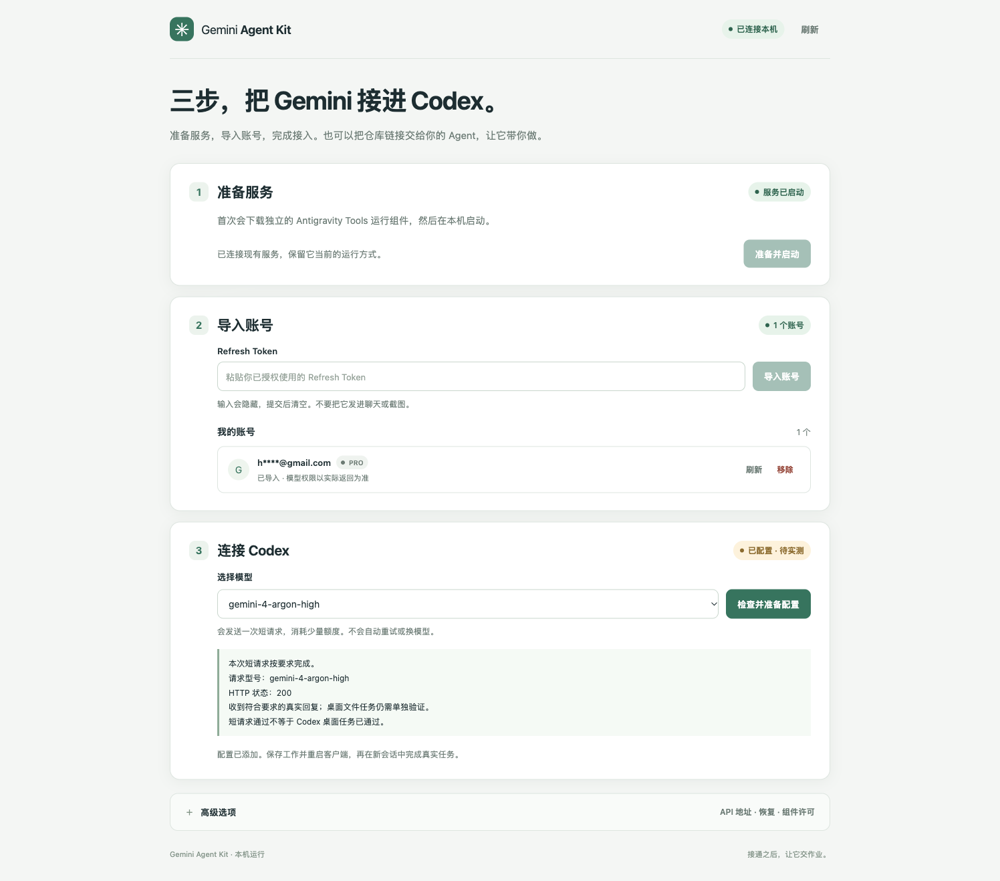

# Gemini Agent Kit

**一个本机面板，导入你授权的账号，把 Gemini 接进 Codex。**

不需要先申请 Google AI Studio 项目密钥。仓库自带账号管理、模型选择和接入界面，使用独立安装的 Antigravity Tools 提供账号连接与上游 API；也可复用你已有的 Manager。它们都是社区工具，不是 Google 官方产品。

<details>
<summary>查看实际面板</summary>



</details>

**复制这一段，发给你的 Agent：**

```text
请读取 https://github.com/zysen1/gemini-agent-kit 的 AGENTS.md，
帮我安装并打开本机面板，
准备服务，
把我授权的 Gemini 来源接进 Codex。
优先复用我已有的 Manager，
否则准备仓库支持的独立组件。
需要账号信息时让我在本机面板输入，
不要让我发到聊天。
读取真实模型目录，
检查一次模型，
备份并添加 Codex 配置，
保留我当前的默认模型。
最后带我在 Codex 新会话完成一个真实文件任务，
分别说明配置、网关检查和桌面实测的结果。
```

自己操作也是三步：

1. **准备服务**：下载仓库，双击 Mac 的 `启动面板.command` 或 Windows 的 `启动面板.bat`，在页面点击「准备并启动」。需要 Python **3.11+**；Windows 首次按提示安装官方组件。
2. **导入账号**：把你授权使用的、`1//` 开头的完整 Refresh Token 填进本机页面，点击「导入账号」。不用粘贴账号密码，也不用发到聊天。
3. **连接 Codex**：选择实际可用的模型，点击「检查并准备配置」，查看预览后「确认接入 Codex」。保存工作、重启 Codex，在设置的网关（Gateways）中启用 Gemini Agent Kit，再新建会话选择模型，做一次真实文件任务。

终端启动方式：

```sh
git clone https://github.com/zysen1/gemini-agent-kit.git
cd gemini-agent-kit
python3 scripts/kit_app.py --open
```

面板地址：**http://127.0.0.1:8787**。使用时保留启动窗口，用 `Ctrl+C` 可关闭面板及它管理的服务。默认只添加 Codex 来源，**不会切换当前默认模型或旧会话**。

进度分别记录为**配置完成、模型短测通过、Codex 桌面真实任务通过**。桌面最后一步需要你在客户端完成；其他 Agent 按各自的接入方式逐个验收。历史 CLI 成果与桌面结果分别记录。

[详细使用与恢复](docs/LOCAL_PANEL.md) · [完整 Agent 口令](PROMPT.md) · [其他 Agent 接法](docs/CLIENTS.md) · [模型与额度](docs/MODELS_AND_LIMITS.md) · [实测记录](docs/STATUS.md)

运行组件固定为 Antigravity Tools **5.0.3**，从上游官方 Release 下载并核验摘要；Windows 使用已安装的官方版本。本仓库原创代码采用 MIT，上游组件采用 **CC BY-NC-SA 4.0**，两者分别适用，见 [第三方声明](THIRD_PARTY_NOTICES.md)。仓库不提供账号或额度，也不承诺无限使用。

<details>
<summary>已有 CLI、Magpie、其他 Agent 与历史实测记录</summary>

## 本次实际交付

| 客户端与路线 | 已完成的真实任务 | 范围与记录 |
| --- | --- | --- |
| Codex CLI 使用 Gemini 模型来源 | 首次与改变输入后的写稿、订单读写，最终 **4/4 项完成** | 历史 8 次 CLI 尝试中 4 次完整结束；最新补验收约 400 秒，包含两轮 120 秒等待 |
| Muse 委托 Gemini 外援 | 首次写稿、订单整理 **2 项成果** | 两次真实调用及落盘文件已核对；主模型不变，稿件仅由宿主规范了 CTA 引号 |
| WorkBuddy 的 Hy4 宿主 + Gemini 外援 | 首次写稿 **1 项成果** | 一次真实调用成功；Hy4 保留原稿，只删掉两段材料未提供的活动安排，最终正文 192 字 |
| WorkBuddy 主模型直连 | 未通过 | 本轮上游 429；不把外援成功写成主模型替换成功 |
| DSH NEXT 自定义模型来源 | 界面与路由已确认；真实短测 **0/1 完成** | 请求到达上游，返回 `429 RESOURCE_EXHAUSTED`；恢复可用后复验，接法见 [DSH 指南](docs/CLIENTS.md#dsh-next) |
| Grok Bot / 虚拟机 Pi | 登录和目录已核对；Pi 文件任务 **0/2 完成** | 两次任务均遇到 429、未产出文件；独立短探针虽收到 HTTP 200，却未按要求生成内容。外层 Grok Bot 周额度耗尽，宿主调度未通过 |

这是本次具体环境的任务记录，保留失败分母与宿主编辑过程。任务最终完成比例、单次请求成功比例与长期稳定性不同，详见[完整验收状态](docs/STATUS.md)。

## CLI 快速开始

需要 Python 3.10+；脚本只用标准库。Windows 可将 `python3` 换成 `py -3`。

```sh
git clone https://github.com/zysen1/gemini-agent-kit.git
cd gemini-agent-kit
python3 scripts/agent_kit.py doctor
python3 scripts/agent_kit.py models
```

如果 Magpie 尚未运行，先打开 [Magpie 官方应用](https://usemagpie.ai/)，或启动已安装的 `magpie serve`。首次使用需要在 Magpie 的 Providers 页面连接你自己的可用模型源。已有来源可直接复用，不要求重新申请官方项目 API。

**使用 Antigravity Manager？** 按[独立指南](docs/ANTIGRAVITY_MANAGER.md)安装、在应用的 Refresh Token 页面导入你主动授权的账号并启用反代，然后给以下命令加 `--base-url http://127.0.0.1:8045/v1`。这条路线不必再装 Magpie。

Manager 可能通过应用内更新替换安装文件。验收时记录 `/v1/version` 的实际运行版本，不能只凭下载过的安装包版本下结论。

从 `models` 输出复制完整 `id`，替换下方占位内容：

```sh
python3 scripts/agent_kit.py verify --model "完整模型 ID" --output reports/gateway-check-01.json
python3 scripts/agent_kit.py launch-codex --model "完整模型 ID"
```

`verify` 会发出最多 3 次短请求，检查文字回复、函数参数和工具结果回传，消耗所选来源的额度。它通过后，仍要在目标客户端完成一个真实任务；它不测 Codex 的 Responses 接口，也不代表所有客户端均已跑通。

若目录中恰好只有一个 Gemini Argon 条目，可省略 `--model`。存在多个来源或其他型号时必须指定，程序不会偷偷换模型。

## 其他客户端

DSH NEXT 可添加独立的 OpenAI Chat Completions 模型来源，保留现有默认模型；按 [DSH 指南](docs/CLIENTS.md#dsh-next)配置后，在应用里选中它并单独验收。

```sh
python3 scripts/agent_kit.py plan --client workbuddy --model "完整模型 ID" --output reports/workbuddy-plan-01.json
python3 scripts/agent_kit.py plan --client muse --model "完整模型 ID" --output reports/muse-plan-01.json
python3 scripts/agent_kit.py plan --client grokbot --model "完整模型 ID" --output reports/grokbot-plan-01.json
```

`plan` 生成可核对的配置，不会替你点击客户端。执行 Agent 应继续按 [AGENTS.md](AGENTS.md) 完成配置、真实任务和验收。Codex 启动器只影响当前 CLI 进程；WorkBuddy 可用自定义模型，也可保留当前主模型使用文件桥外援；Muse / Grok Bot 的通用路线是 `ask_gemini` 外部工具，原 Agent 继续规划任务。具有已授权设备文件工具时，可按[文件桥接指南](docs/FILE_BRIDGE.md)让本机 worker 代为调用，仍属于外部工具接入。

同一本机 Manager 的连续工具回合需要冷却时，可使用[请求排队代理](docs/PACED_PROXY.md)，把本次客户端地址改为 `http://127.0.0.1:8046/v1`。它串行等待，不增加额度、不改型号、不自动重试；真实客户端状态以[验收记录](docs/STATUS.md)为准。

本机已正常升级并核验 Manager `5.0.3`，排队间隔调为 120 秒。等待期间检测到客户端断连会取消尚未发出的请求；点击停止但连接未关闭的情况仍需由客户端处理。升级后的 WorkBuddy 主模型直连仍出现上游 429，因此本仓库不承诺消除额度限制；版本差异见[Manager 指南](docs/ANTIGRAVITY_MANAGER.md)。

## 网关在哪里

默认地址是 `http://127.0.0.1:3425/v1`。修改端口或使用其他兼容网关时，给命令加 `--base-url`。例如：

```sh
python3 scripts/agent_kit.py doctor --base-url http://127.0.0.1:8080/v1
```

本机 Magpie 使用客户端标签即可。其他网关若需要密钥，在执行环境中私下设置 `GEMINI_AGENT_GATEWAY_KEY`；程序不会读取 `.env` 文件。远程网关默认要求 HTTPS 和该环境变量。别把上游账号密码或 Refresh Token 填进这个变量。

Manager 的 **API 网关密钥** 用于客户端连接；Google **Refresh Token** 仅用于 Manager 的账号导入。两者不同，均不需要作为公开素材或上传到 GitHub。

云端 Agent 里的 `127.0.0.1` 是云端自己的电脑。应在其运行环境中部署网关，或使用已有的、带鉴权的 HTTPS 网关；本项目不会自动公开你的电脑。

## 这个仓库负责什么

| 能力 | 范围 |
| --- | --- |
| `doctor` / `models` | 检查环境和网关，读取动态目录，不发推理请求 |
| `verify` | 真实网关的短文本与工具往返检查，保存脱敏 JSON |
| `launch-codex` | 用独立 provider 启动 Codex CLI，不改全局配置 |
| `plan` | 生成客户端配置说明，不把“计划生成”算作“配置完成” |
| `mcp` | 提供 stdio MCP 工具 `ask_gemini`，把指定文字任务交给所选模型 |
| `file_bridge.py` | 用已授权的设备文件读写交接请求和结果；本机 worker 调用网关，保留独立回执 |
| `paced_proxy.py` | 为本机 `8045` 网关增加串行冷却，客户端使用 `8046`；不自动重试 |

上表是原有 CLI 工具。新增本机面板还提供账号管理界面、独立组件生命周期、带鉴权的本机 API 和可恢复的 Codex 配置；上游来源连接与协议转换由独立的 Antigravity Tools 承担。仓库本身没有账号、订阅或模型额度，也不承诺某种消费者订阅必然能转换成 API。关于 Google 登录路径与型号权限，见 [模型与额度说明](docs/MODELS_AND_LIMITS.md)。

## 开发验证

```sh
python3 -m unittest discover -s tests -v
```

这些测试使用本地模拟服务验证程序行为，不会调用真实 Gemini。测试通过与真实模型、客户端端到端成功是不同的证据，见 [STATUS](docs/STATUS.md)。

</details>
